```{python}
#| echo: false
#| output: false
import pandas as pd
from pathlib import Path
PROC = Path("../data/processed")

visitors   = pd.read_csv(PROC / "visitors_annual.csv")
fred       = pd.read_csv(PROC / "employment_fred_annual.csv")
bea_af     = pd.read_csv(PROC / "bea_af_real.csv")
bea_gdp    = pd.read_csv(PROC / "bea_gdp_real.csv")
bea_share  = pd.read_csv(PROC / "bea_af_share.csv")
qcew       = pd.read_csv(PROC / "employment_qcew.csv")
nps        = pd.read_csv(PROC / "nps_viis.csv")
hotel      = pd.read_csv(PROC / "hotel_annual.csv")
```

This report follows one analytical question through the principal evidence: did the USVI tourism economy return to its former scale after 2017 and 2020, or did it return to visitor activity on a smaller operational base? It distinguishes sources and reference periods rather than forcing them into a single composite result.

---

:::{.analysis-section-header}
:::{.section-number}
Section 1 of 5
:::
:::
# Visitor activity

:::{.analytical-question}
How did the scale and composition of visitor arrivals change across the 2017 and 2020 shocks? The answer requires keeping published arrival measures separate.
:::

:::{.section-intro}
USVIBER publishes total visitors, air visitors, and cruise passengers as separate series. They are not components of a sum: air visitors and cruise passengers cannot be assumed to add to the published total. The two shocks interrupted these flows in different ways and at different proportions.
:::

::: {#fig-analysis-arrivals}
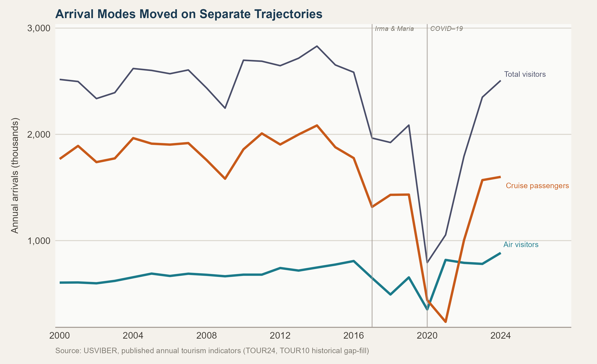{.light-content #fig-analysis-arrivals fig-alt="Line chart showing air visitors, cruise passengers, and total arrivals from 2000 to 2024"}

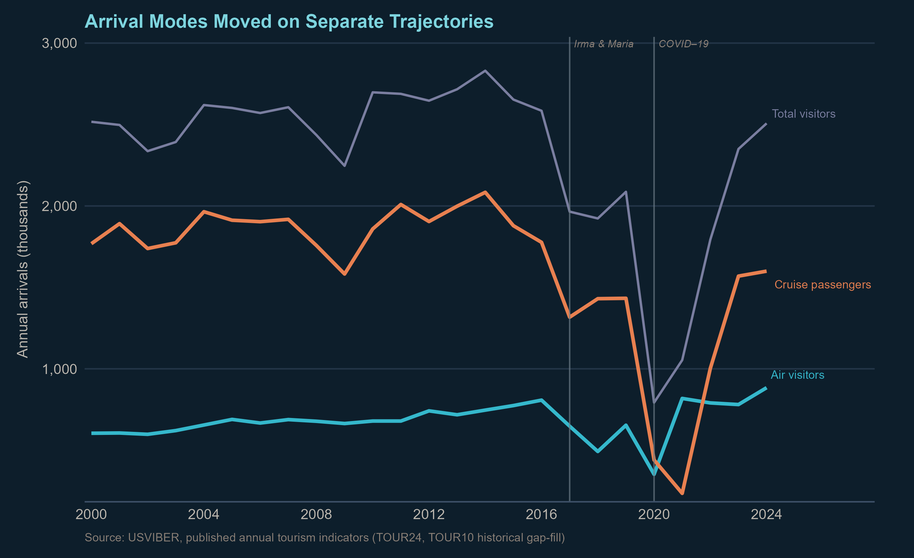{.dark-content #fig-analysis-arrivals-dk fig-alt="Line chart showing air visitors, cruise passengers, and total arrivals from 2000 to 2024"}

Published total visitors is a USVIBER aggregate. It should not be reconstructed from the air and cruise series, which do not reliably sum to the published total. Historical coverage combines TOUR24 (2000, 2010–2024) and TOUR10 (2001–2009 gap-fill).
:::

Total arrivals fell from 2.585 million in 2016 to 2.143 million in 2018, or 83% of the 2016 level. The 2020 low was not the same as the hurricane interruption: COVID closed cruise shipping and sharply restricted air travel. In 2024, air arrivals were 884,200, 109% of their 2016 level, and cruise passengers were 1.600 million, 90%. The published total was 2.507 million, 97%.

The 2019–2020 comparison clarifies the character of the pandemic. Air visitors fell from 653,700 to 206,300, while cruise passengers fell from 1.433 million to 358,900. Both measures rebounded, but cruise traffic remained structurally weaker after 2020.

**Island-level arrivals reveal different cruise trajectories.** At the island-group level, cruise traffic followed distinct paths. By 2024, STT (St. Thomas–St. John) cruise arrivals were at 90% of their 2016 level. STX (St. Croix) cruise arrivals were at 144%. The STX number reflects partly the lower 2016 baseline: STX cruise was itself well below early-2000s peaks (240,000+) in 2016. The divergence is real but should not be read as STX cruise recovering more fully from the 2017 disruption alone — it was building from a structurally lower starting point.

::: {#fig-analysis-expenditure}
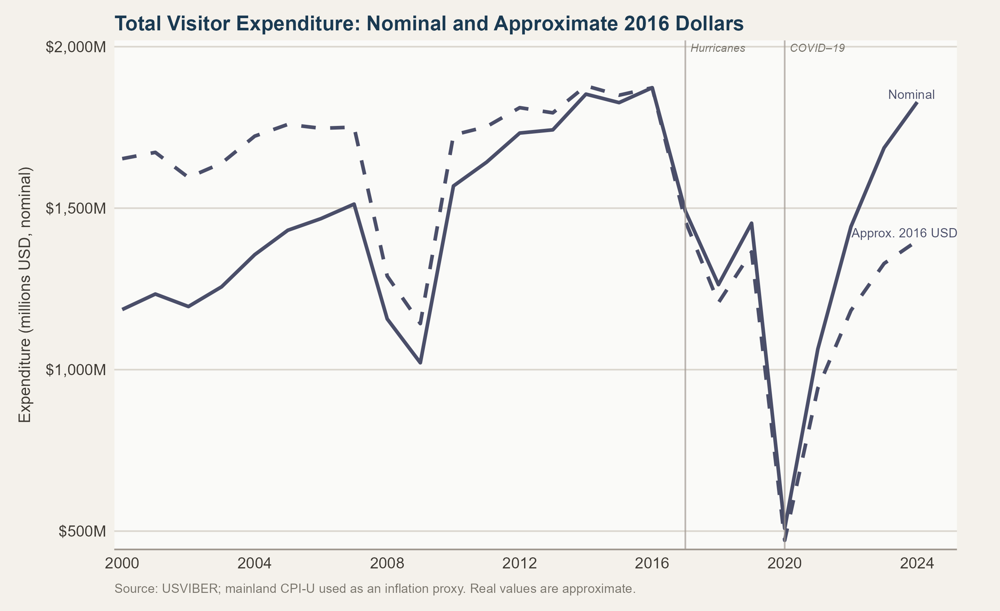{.light-content #fig-analysis-expenditure fig-alt="Line chart showing visitor expenditure nominal and real from 2000 to 2024"}

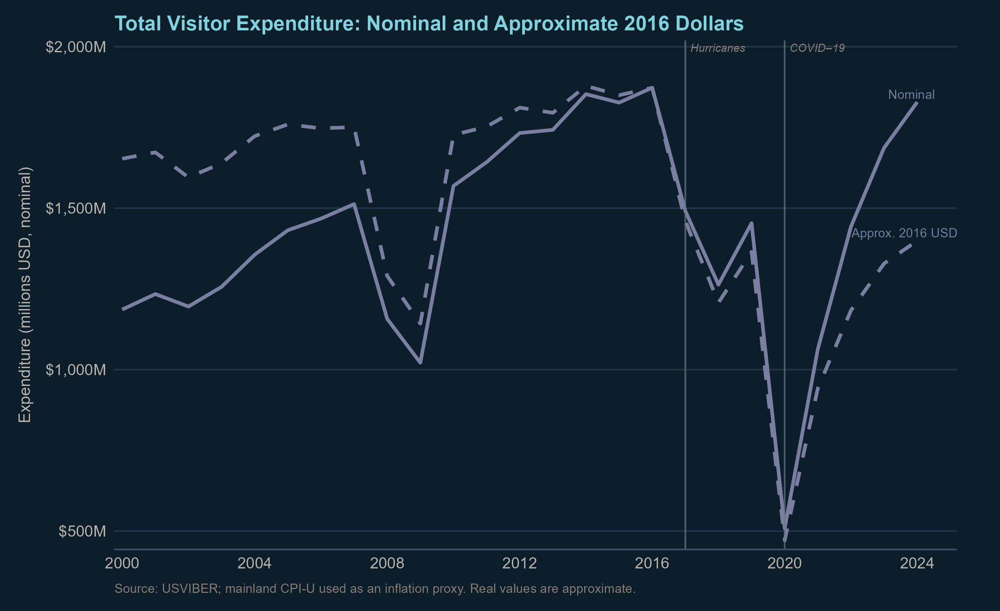{.dark-content #fig-analysis-expenditure-dk fig-alt="Line chart showing visitor expenditure nominal and real from 2000 to 2024"}

Nominal expenditure in millions of current USD; approximate real series uses mainland CPI-U as an inflation proxy. This is not a USVI-specific purchasing-power estimate.
:::

Nominal expenditure recovered to $1.829 billion in 2024, 98% of its 2016 value. In approximate 2016 dollars, it was $1.399 billion, 75% of 2016. That real comparison should be read with care: mainland CPI-U is only a proxy, and USVI expenditure may contain substantial changes in trip composition that a deflator cannot isolate.

There is no defensible category-level expenditure breakdown in the available data. The report therefore uses total visitor expenditure only.

## Visitor scorecard

| Measure | Benchmark | Latest | Value | Interpretation |
|---|---:|---:|---:|---|
| Air visitors | 2016 | 2024 | 109% | Above 2016 |
| Cruise passengers | 2016 | 2024 | 90% | Below 2016 |
| Total visitors | 2016 | 2024 | 97% | Near 2016 |
| Total expenditure, nominal | 2016 | 2024 | 98% | Near 2016 |
| Total expenditure, approx. 2016 USD | 2016 | 2024 | 75% | Below 2016; mainland CPI-U proxy |

---

:::{.analysis-section-header}
:::{.section-number}
Section 2 of 5
:::
:::
# Accommodation capacity and utilization

:::{.analytical-question}
Did hotel capacity return as visitor traffic did, and what does reported occupancy actually establish?
:::

:::{.section-intro}
Two distinct data sources measure accommodation capacity. USVIBER's annual survey tracks hotel-room inventory continuously. The Census Economic Census provides establishment and guestroom snapshots at five-year intervals. Their totals differ in ways that cannot be reconciled — they count different populations.
:::

::: {#fig-analysis-rooms}
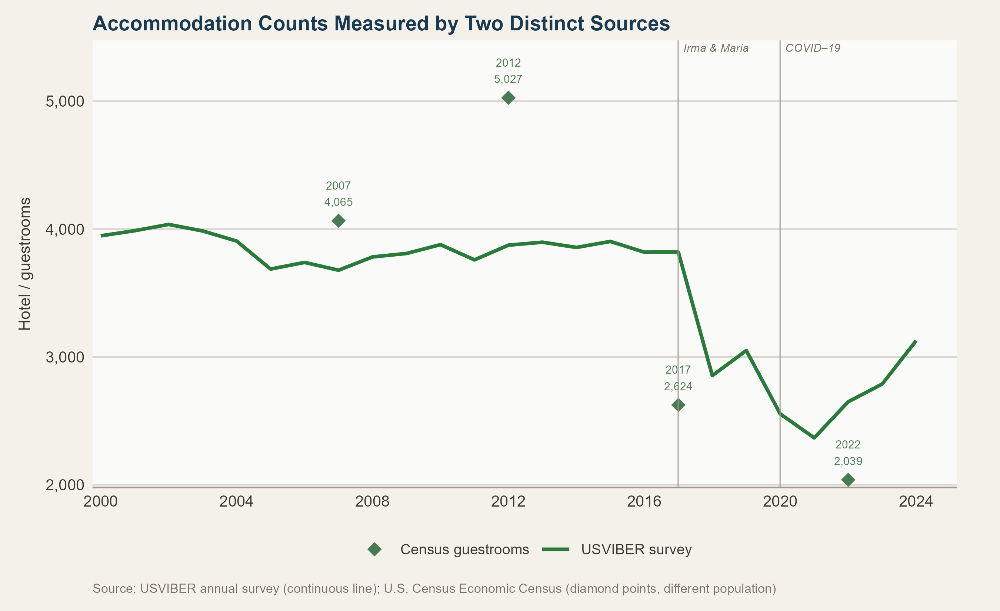{.light-content #fig-analysis-rooms fig-alt="Line chart of USVIBER hotel rooms with Census guestroom snapshot points"}

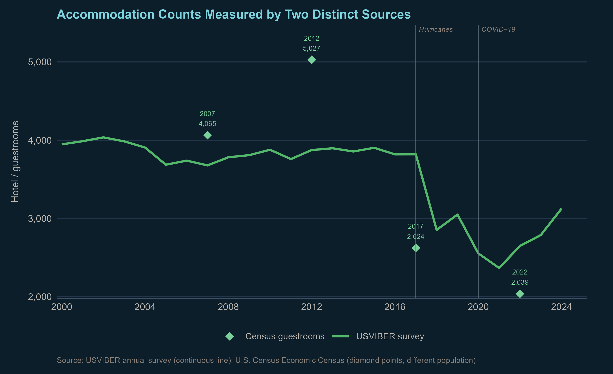{.dark-content #fig-analysis-rooms-dk fig-alt="Line chart of USVIBER hotel rooms with Census guestroom snapshot points"}

USVIBER hotel rooms: continuous annual survey. Census guestrooms: four snapshots (2007, 2012, 2017, 2022), not connected. The two series represent different populations and should not be combined into a single capacity trend.
:::

USVIBER hotel rooms fell from 3,819 in 2016 to 3,127 in 2024, 82% of the earlier level. Census guestroom counts fell from 5,027 in 2012 to 2,039 in 2022. The Census vintages use different guestroom definitions, and the 2017 count is a December 31 post-hurricane snapshot — it is not a pre-hurricane baseline for 2017.

::: {#fig-analysis-occupancy}
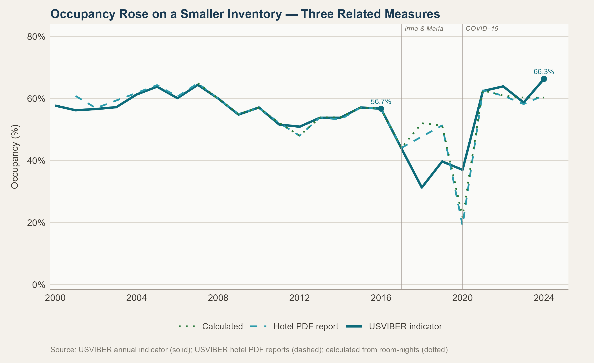{.light-content #fig-analysis-occupancy fig-alt="Line chart showing three occupancy measures from 2001 to 2025"}

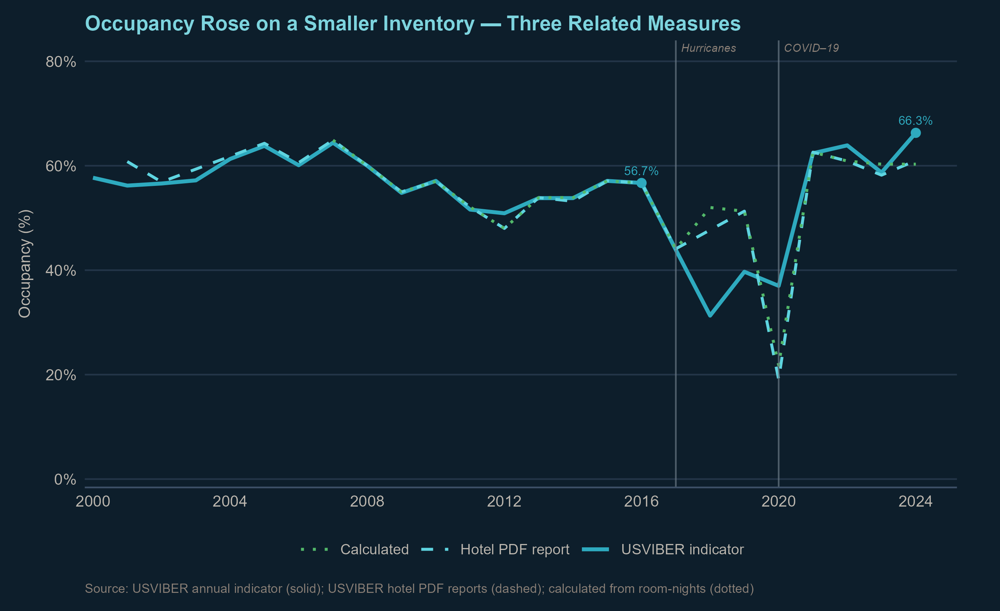{.dark-content #fig-analysis-occupancy-dk fig-alt="Line chart showing three occupancy measures from 2001 to 2025"}

Three related measures: (1) USVIBER annual indicator occupancy (solid) — 66.3% in 2024; (2) occupancy from individual USVIBER hotel PDF reports (dashed) — 61.0% in 2024; (3) calculated from published room-nights available and occupied (dotted) — 60.3% in 2024. These are distinct series from different USVIBER publications and should not be treated as equivalent.
:::

The USVIBER annual indicator reached 66.3% in 2024, 9.6 percentage points above the 56.7% reported in 2016. The hotel-specific published rate from PDF reports was 61.0% in 2024. The calculated rate from room-night data was 60.3%. All three show higher utilization in 2024 than in 2016.

Higher utilization on a smaller inventory does not establish whether total occupied room-nights, revenue, or profitability recovered. It means the remaining inventory was used more intensively.

## Census guestroom crosswalk

| Year | Guestrooms | Establishments | Basis |
|---:|---:|---:|---|
| 2007 | 4,065 | 47 | A10 industry total |
| 2012 | 5,027 | 54 | A10 industry total |
| 2017 | 2,624 | 46 | NAPCS 7003825000; December 31, post-hurricane |
| 2022 | 2,039 | 51 | NAPCS 7003825000 |

## Accommodation scorecard

| Measure | Benchmark | Latest | Value | Interpretation |
|---|---:|---:|---:|---|
| USVIBER hotel rooms | 2016 | 2024 | 82% | Smaller inventory |
| Annual indicator occupancy | 2016 rate | 2024 | 66.3%; +9.6 pp | Higher utilization of smaller stock |
| Hotel PDF report occupancy | 2016 rate | 2024 | 61.0% | Different USVIBER source |
| Calculated room-night occupancy | 2016 rate | 2024 | 60.3% | Nights occupied / nights available |
| 2025 occupied room-nights | n/a | 2025 | Not available | Partial reporting only |

## Island-level accommodation: St. Thomas–St. John vs. St. Croix

:::{.context-panel}
The territory-wide accommodation shortfall masks a stark geographic difference. By 2024, St. Thomas–St. John available room-nights were 75% of their 2016 level. St. Croix available room-nights were 95%. The territorial deficit is overwhelmingly concentrated on the two northern islands.
:::

::: {#fig-analysis-hotel-island}
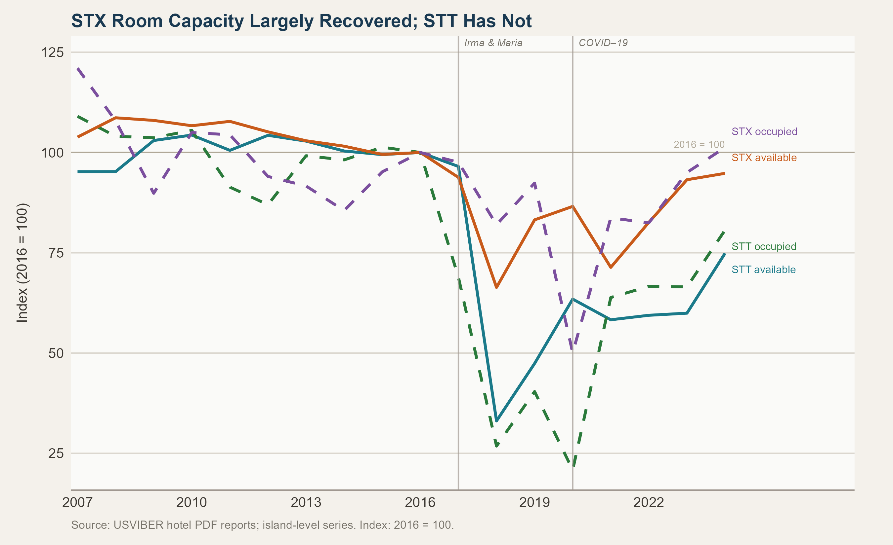{.light-content #fig-analysis-hotel-island fig-alt="Line chart of STT and STX hotel room-nights indexed to 2016=100"}

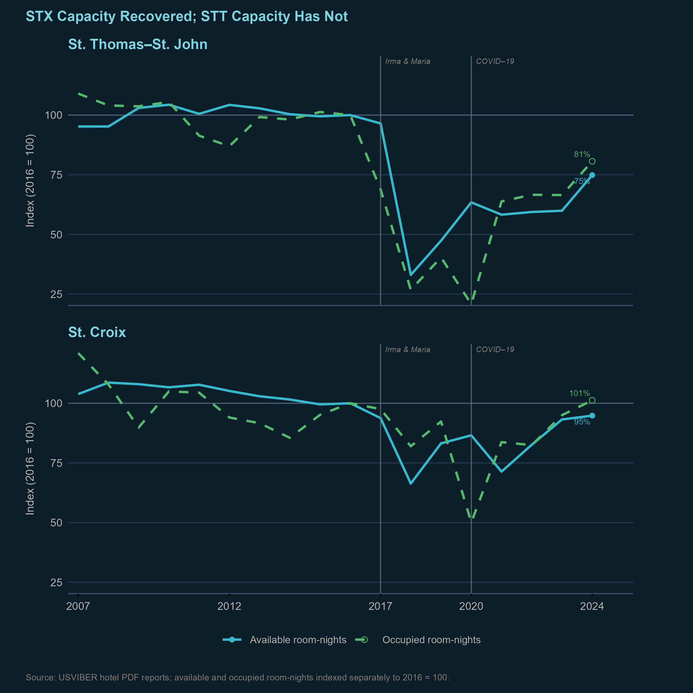{.dark-content #fig-analysis-hotel-island-dk fig-alt="Line chart of STT and STX hotel room-nights indexed to 2016=100"}

Room nights available and occupied indexed to 2016 = 100, by island group. STT = St. Thomas–St. John; STX = St. Croix. 2025 occupied room-nights not available. Source: USVIBER hotel PDF reports.
:::

By 2024, STT available room-nights were 75% of their 2016 level and occupied room-nights were 81%. STX available room-nights were 95% of 2016, and occupied room-nights were essentially at 2016 (101%).

The territory-wide 82% hotel-room figure is overwhelmingly an STT story. St. Croix's hotel capacity, measured in published available room-nights, had almost returned to its 2016 level by 2024. The territory-wide accommodation deficit reflects the still-unrebuilt capacity on St. Thomas and St. John.

Occupancy rose at both islands: STT from 59.9% in 2016 to 64.5% in 2024; STX from 46.6% to 52.0%. As before, higher occupancy on a smaller inventory does not mean more total room-nights sold.

## Island accommodation scorecard

| Measure | STT (2024) | STX (2024) |
|---|---:|---:|
| Available room-nights | 75% | 95% |
| Occupied room-nights | 81% | 101% |
| Published occupancy | 64.5% (+4.6 pp) | 52.0% (+5.4 pp) |

*Source: USVIBER hotel PDF reports. 2025 occupied room-nights not available.*

---

:::{.analysis-section-header}
:::{.section-number}
Section 3 of 5
:::
:::
# Employment

:::{.analytical-question}
Which employment measures support a labor-market recovery claim, and which are too different to compare directly?
:::

:::{.section-intro}
Four independent sources measure employment in the USVI tourism-adjacent labor market. They count different populations, use different reference periods, and are not interchangeable. FRED/BLS covers the broadest sector; QCEW covers UI-insured jobs; the Census Economic Census provides establishment-level snapshots. USVIBER surveys selected tourism-related jobs.
:::

:::{#fig-analysis-employment-fred}
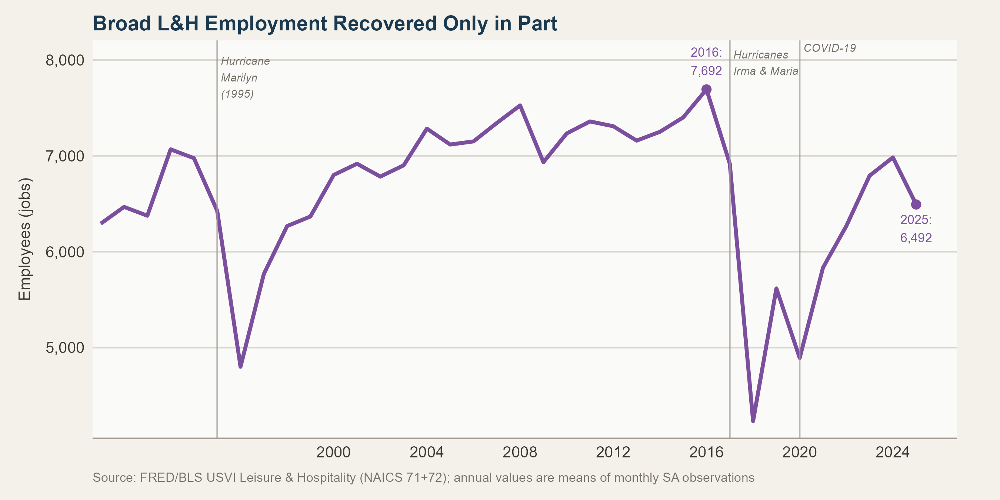{.light-content #fig-analysis-fred fig-alt="Line chart of FRED L&H employment annual means"}

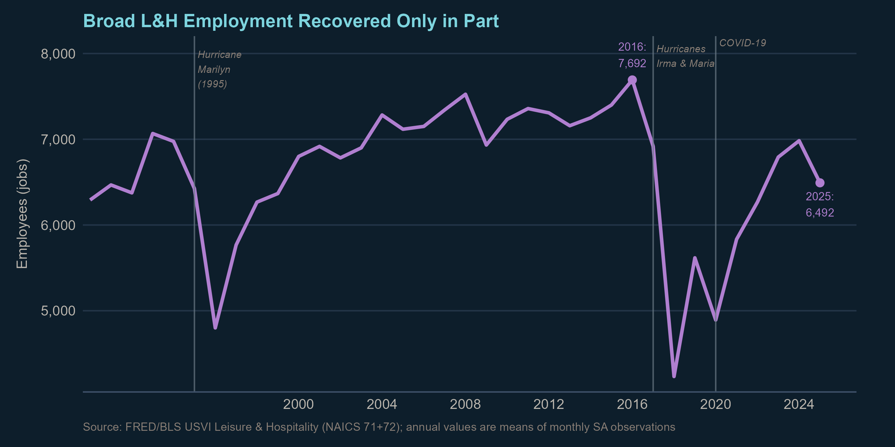{.dark-content #fig-analysis-fred-dk fig-alt="Line chart of FRED L&H employment annual means"}

FRED/BLS Leisure and Hospitality employment (NAICS 71+72), seasonally adjusted monthly series. Annual values shown here are arithmetic means of twelve monthly observations.
:::

The FRED series covers broad NAICS 71+72, not tourism employment alone. Its 2024 annual mean was 6.98 thousand employees, 91% of the 7.69 thousand 2016 mean. The 2025 mean was 6.49 thousand, 84%. This is a decline in the broad sector from 2024, even though 2024 visitor arrivals were near 2016.

:::{#fig-analysis-employment}
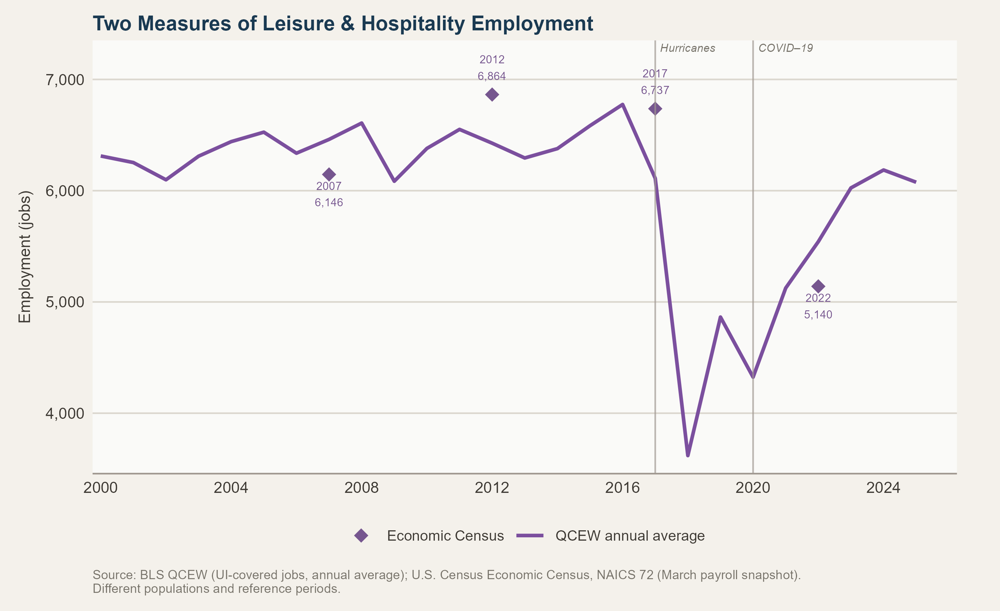{.light-content #fig-analysis-employment fig-alt="Two-panel chart: QCEW continuous series and Census snapshot points"}

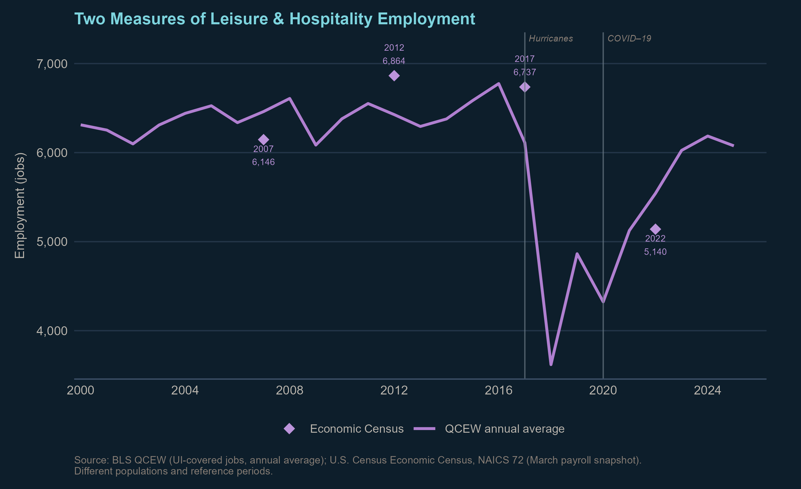{.dark-content #fig-analysis-employment-dk fig-alt="Two-panel chart: QCEW continuous series and Census snapshot points"}

Top: QCEW NAICS 72 (Accommodation and Food Services) annual average covered jobs, territory total. Bottom: Census Economic Census employment snapshots at four points (2007, 2012, 2017, 2022). The two panels use different populations, definitions, and reference periods and are not directly comparable.
:::

QCEW employment fell from 6,775 annual average jobs in 2016 to 3,826 in 2020 and was 6,275 in 2025. It is UI-covered employment, not a count of people. Average annual pay is total wages divided by annual average employment, not typical individual earnings.

The Census Economic Census provides only 2007, 2012, 2017, and 2022 snapshots. Accommodation employment was 3,876 in 2012 and 1,650 in 2022. It cannot be treated as an annual series or directly combined with QCEW or FRED. The 2017 figure reflects a mid-disruption snapshot taken after the September hurricanes.

:::{#fig-analysis-employment-sources}
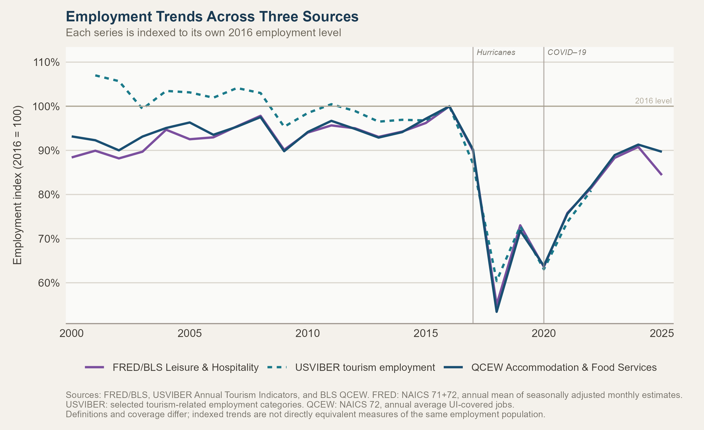{.light-content #fig-analysis-employment-sources fig-alt="Two-panel chart: FRED, USVIBER, and QCEW employment measures"}

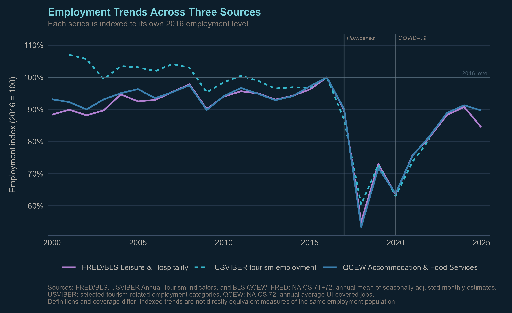{.dark-content #fig-analysis-employment-sources-dk fig-alt="Two-panel chart: FRED, USVIBER, and QCEW employment measures"}

Each series indexed to its own 2016 employment level. FRED/BLS: Leisure and Hospitality (NAICS 71+72), annual mean; USVIBER: selected tourism-related employment categories; QCEW: Accommodation and Food Services (NAICS 72), annual average covered jobs. Different employment definitions and populations; indices compare relative change, not equivalent job counts.
:::

## Employment scorecard

| Measure | Benchmark | Latest | Value | Interpretation |
|---|---:|---:|---:|---|
| FRED L&H employment | 2016 annual mean | 2025 | 84% | Broad sector below 2016 |
| FRED L&H employment | 2016 annual mean | 2024 | 91% | Partial recovery, then 2025 decline |
| QCEW NAICS 72 jobs | 2016 | 2025 | 93% | UI-covered annual average jobs |
| USVIBER tourism employment | 2016 | 2022 | 81% | Selected tourism-related jobs below 2016 |
| Census accommodation employment | 2012 | 2022 | 43% | March snapshot; different source and industry coverage; early in recovery |

---

:::{.analysis-section-header}
:::{.section-number}
Section 4 of 5
:::
:::
# Economic output

:::{.analytical-question}
What can BEA GDP and industry value-added data establish about tourism activity, and what falls outside their scope?
:::

:::{.section-intro}
BEA provides two distinct measures. Real GDP covers the entire territorial economy and all industries — it is not a tourism measure. Real Accommodation and Food Services value added covers a broad industry that includes resident-serving activity. Neither series isolates tourism output or attributes economic change to any specific cause.
:::

:::{#fig-analysis-gdp}
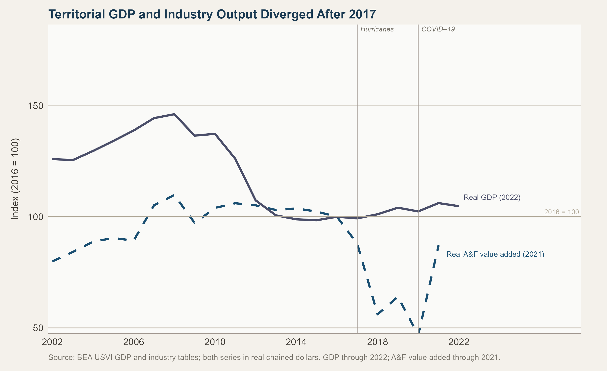{.light-content #fig-analysis-gdp fig-alt="Line chart of real GDP and real A&F value added indexed to 2016=100"}

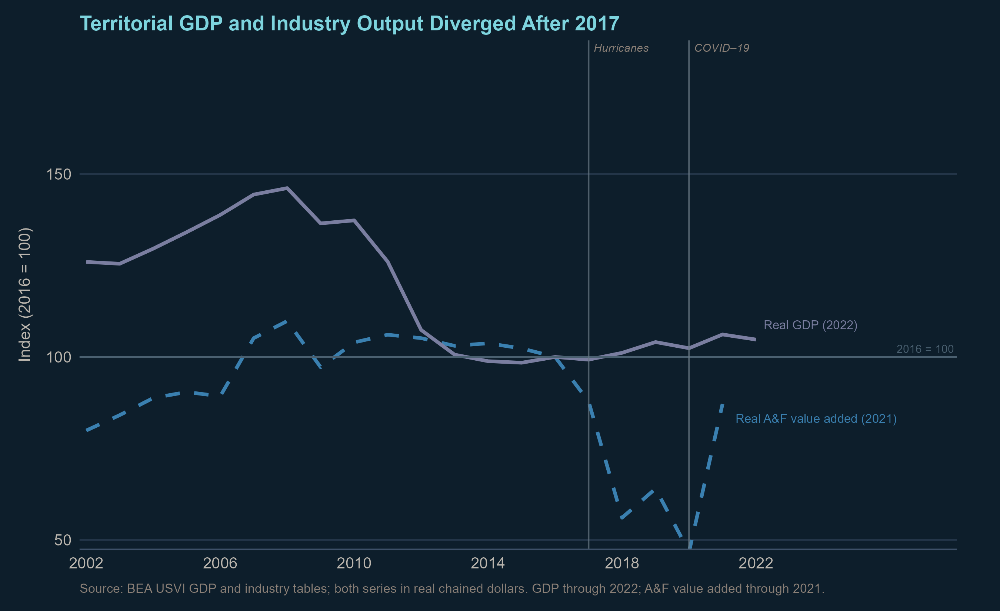{.dark-content #fig-analysis-gdp-dk fig-alt="Line chart of real GDP and real A&F value added indexed to 2016=100"}

Real GDP (solid) and real Accommodation and Food Services value added (dashed), each indexed to 2016 = 100. Latest GDP observation: 2022. Latest A&F observation: 2021. BEA real series use chained dollars.
:::

Real GDP rose from 100 in 2016 to 119 in 2022 — above the hurricane benchmark. Accommodation and Food Services real value added reached 87 in 2021, the last available industry observation — still below 2016.

These are different concepts. Real GDP includes the entire territorial economy. Accommodation and Food Services is a broad industry that includes resident-serving activity and excludes tourism-related spending in transportation, retail, and recreation.

:::{#fig-analysis-af-share}
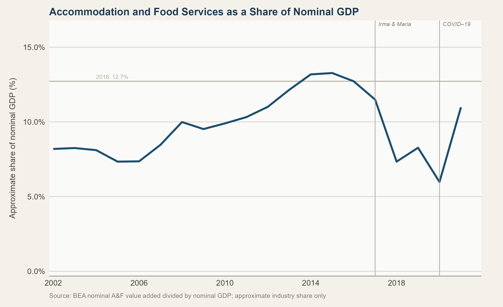{.light-content #fig-analysis-af-share fig-alt="Line chart of A&F share of nominal GDP"}

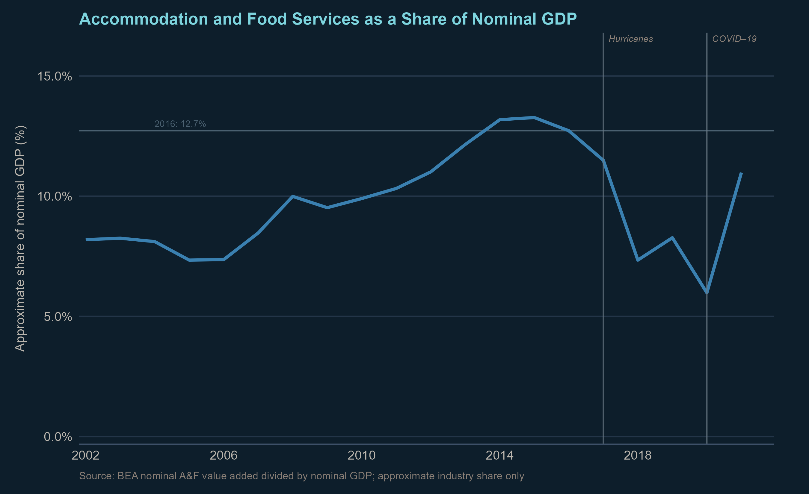{.dark-content #fig-analysis-af-share-dk fig-alt="Line chart of A&F share of nominal GDP"}

Accommodation and Food Services nominal value added divided by nominal GDP. The numerator and denominator are not fully equivalent concepts, so this is an approximate industry share, not a tourism GDP estimate.
:::

The A&F share of nominal GDP fell from 12.7% in 2016 to 11.0% in 2021, with a 6.0% low in 2020. Disaster-recovery funding may help explain the GDP trajectory after 2017, but the BEA series alone does not establish a causal channel or quantify any effect.

## Economic-output scorecard

| Measure | Benchmark | Latest | Value | Interpretation |
|---|---:|---:|---:|---|
| Real GDP | 2016 | 2022 | 119% | Above 2016; whole economy |
| Real A&F value added | 2016 | 2021 | 87% | Industry output below 2016 |
| A&F share of nominal GDP | 2016 | 2021 | 11.0% vs. 12.7% | Approx. share down 1.7 pp |

## 2021 snapshot

By 2021, air arrivals had returned to their 2016 level, but cruise passengers remained at just 13%. Hotel inventory stood at 62% of its baseline, while broad Leisure & Hospitality employment was at 76% and real Accommodation & Food Services value added at 87%. The visitor economy was not recovering as a single unit: different parts of it were moving at very different speeds.

:::{#fig-analysis-2021-snapshot}
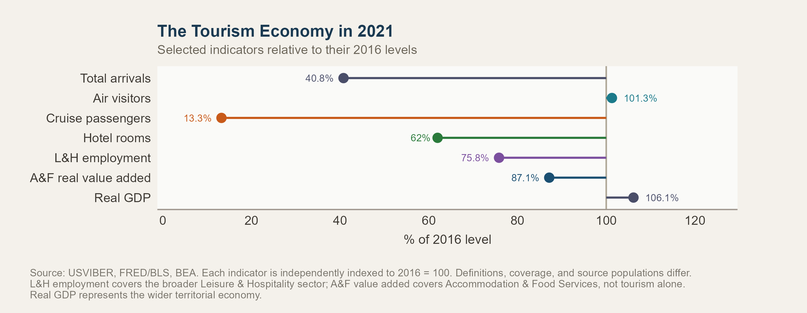{.light-content #fig-analysis-2021-snapshot fig-alt="Multi-line chart showing 2021 common-year recovery snapshot"}

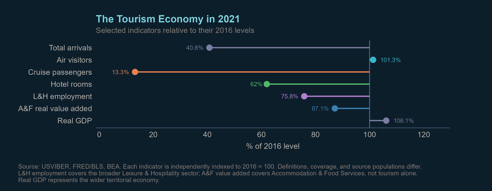{.dark-content #fig-analysis-2021-snapshot-dk fig-alt="Multi-line chart showing 2021 common-year recovery snapshot"}

Each indicator is independently indexed to its 2016 level (2016 = 100%). Measures differ in definition, coverage, and source population; their relative positions should not be interpreted as directly comparable quantities. 2021 reflects an ongoing pandemic-era recovery, not the eventual outcome.
:::

---

:::{.analysis-section-header}
:::{.section-number}
Section 5 of 5
:::
:::
# Cross-indicator recovery

:::{.analytical-question}
Where do the indicators converge, where do they diverge, and what is defensible to conclude?
:::

:::{.section-intro}
The preceding sections establish independent evidence for different dimensions of the tourism economy. This section brings the principal indicators together on a common index scale to show where they converge and where they diverge. No single recovery number exists; the aggregate pattern is the finding.
:::

:::{#fig-analysis-recovery}
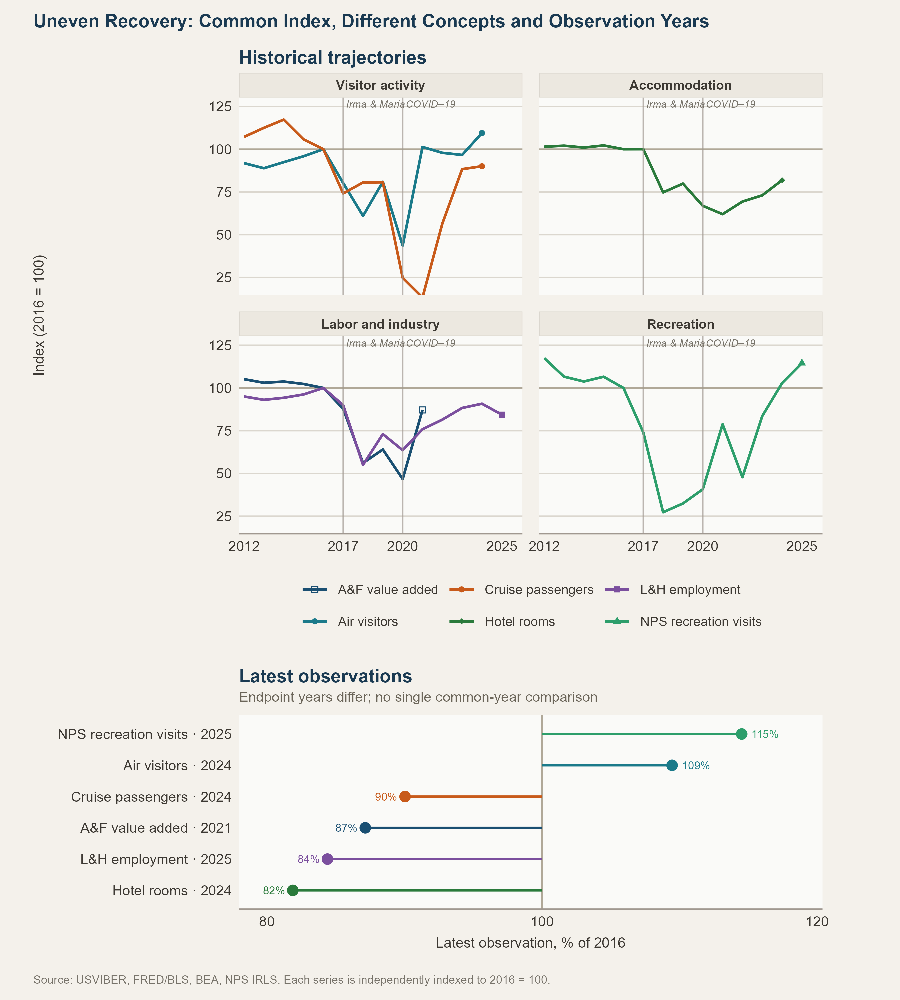{.light-content #fig-analysis-recovery fig-alt="Multi-line chart showing six indicators indexed to 2016=100"}

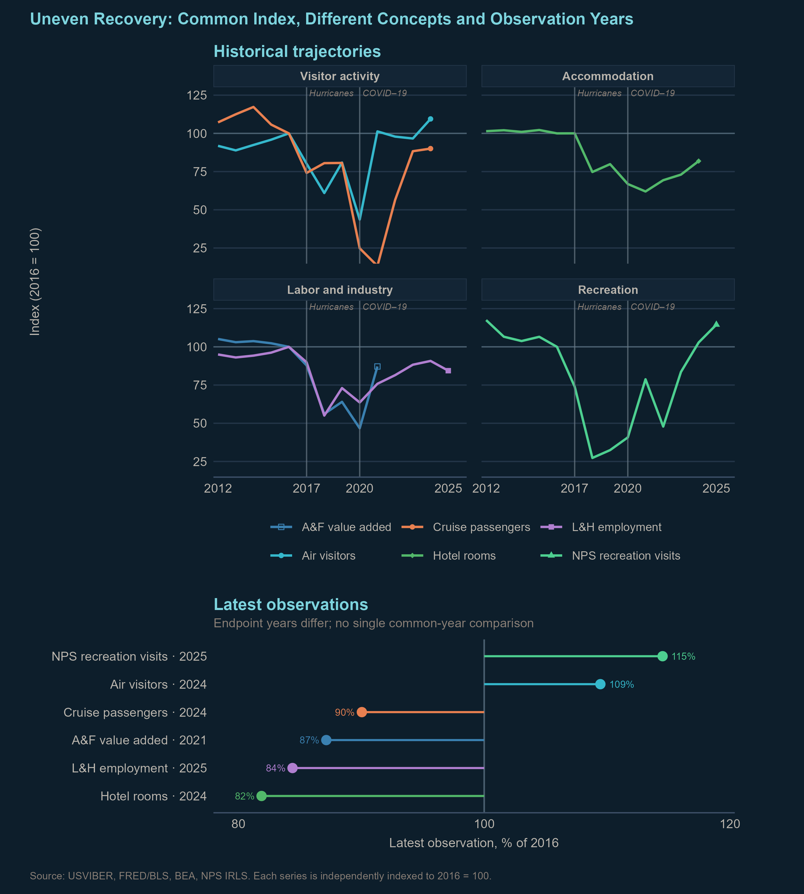{.dark-content #fig-analysis-recovery-dk fig-alt="Multi-line chart showing six indicators indexed to 2016=100"}

Six indicators indexed independently to 2016 = 100. Latest observation years differ: air visitors and cruise through 2024; hotel rooms through 2024; L&H employment through 2025; A&F real value added through 2021; NPS recreation visits through 2025. Occupancy is not indexed because a rate is not interpretable on this scale. Sources: USVIBER, FRED/BLS, BEA, NPS IRLS.
:::

The lines separate around two shocks. Visitor modes are the fastest to change in 2020 and the most varied in 2024. Capacity and broad employment remain lower than before 2017. A&F real value added is lower in the latest available industry observation. Real GDP is higher, but it covers the whole territorial economy.

NPS VIIS visitation adds a useful but non-equivalent recreation signal. The 2025 value is 115% of 2016, but the series uses estimated recreation visits and changed its counting method in 2022. It is not a count of unique visitors or a substitute for arrival counts.

## Final synthesis scorecard

| Measure | Benchmark | Latest year | Value | Interpretation |
|---|---:|---:|---:|---|
| Air visitors | 2016 | 2024 | 109% | Strong recovery |
| Cruise passengers | 2016 | 2024 | 90% | Partial recovery |
| Total visitors | 2016 | 2024 | 97% | Near baseline |
| USVIBER hotel rooms | 2016 | 2024 | 82% | Smaller inventory |
| Annual indicator occupancy | 2016 rate | 2024 | 66.3%; +9.6 pp | Higher utilization |
| FRED L&H employment | 2016 annual mean | 2025 | 84% | Partial or renewed weakness |
| Real A&F value added | 2016 | 2021 | 87% | Below baseline; not tourism GDP |
| Real GDP | 2016 | 2022 | 119% | Broader economy above baseline |
| VIIS recreation visits | 2016 | 2025 | 115% | Above 2016; different population |

:::{.closing-synthesis}
The strongest supported conclusion is not that the tourism economy fully recovered or failed to recover. It is that **recovery is heterogeneous**. Arrivals, particularly air arrivals, have returned more completely than accommodation inventory and broad labor measures. Economic output at the territorial level is above 2016 while the Accommodation and Food Services industry remains below it.

The available data do not establish that the post-2020 economy is structurally permanent, nor can they identify the causal share of hurricanes, pandemic losses, federal recovery spending, or changes in visitor behavior. They establish that 2016 is no longer a uniform benchmark for every dimension of the USVI economy.
:::