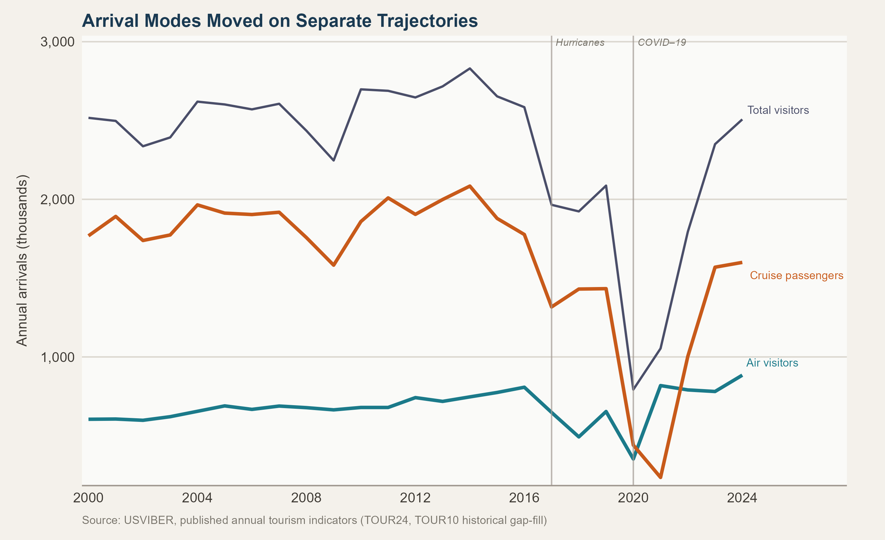
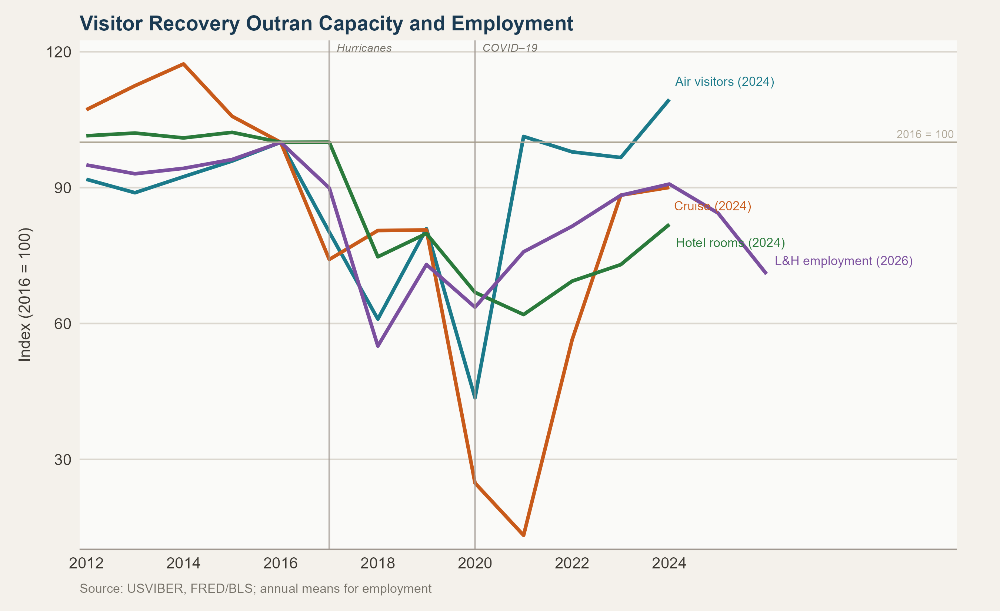
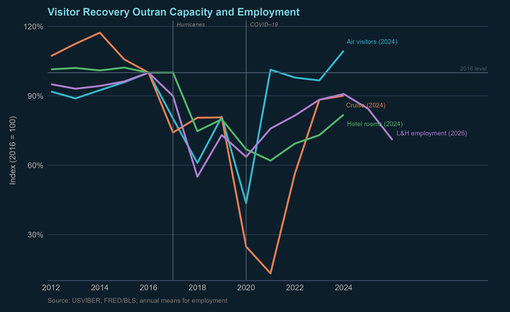

```{=html}
<style>
#title-block-header {
  display: none !important;
}
#quarto-content {
  padding-top: 0;
}
#quarto-content main.content {
  padding-top: 0 !important;
  margin-top: 0 !important;
}
.pub-hero {
  margin-top: 0 !important;
}
</style>
```

```{python}
#| echo: false
#| output: false
import pandas as pd
from pathlib import Path
PROC = Path("../data/processed")

# Load processed data for inline values only
visitors = pd.read_csv(PROC / "visitors_annual.csv")
fred     = pd.read_csv(PROC / "employment_fred_annual.csv")
bea_af   = pd.read_csv(PROC / "bea_af_real.csv")
bea_gdp  = pd.read_csv(PROC / "bea_gdp_real.csv")
nps      = pd.read_csv(PROC / "nps_viis.csv")
hotel    = pd.read_csv(PROC / "hotel_annual.csv")

v16  = visitors[visitors.year == 2016].iloc[0]
v24  = visitors[visitors.year == 2024].iloc[0]
e16  = fred[fred.year == 2016].iloc[0]
e25  = fred[fred.year == 2025].iloc[0]
af21 = bea_af[bea_af.year == 2021].iloc[0]
af16 = bea_af[bea_af.year == 2016].iloc[0]
gdp22 = bea_gdp[bea_gdp.year == 2022].iloc[0]
gdp16 = bea_gdp[bea_gdp.year == 2016].iloc[0]
nps25 = nps[nps.year == 2025].iloc[0]
nps16 = nps[nps.year == 2016].iloc[0]

air_pct   = round(v24.air_visitors / v16.air_visitors * 100)
cruise_pct = round(v24.cruise_passengers / v16.cruise_passengers * 100)
total_pct  = round(v24.total_visitors / v16.total_visitors * 100)
rooms_pct  = round(v24.hotel_rooms / v16.hotel_rooms * 100)
emp_pct25  = round(e25.emp_sa_avg / e16.emp_sa_avg * 100)
af_pct     = round(af21.af_real / af16.af_real * 100)
gdp_pct    = round(gdp22.gdp_real / gdp16.gdp_real * 100)
nps_pct    = round(float(nps25.recreation_visitors) / float(nps16.recreation_visitors) * 100)
nps25_k    = round(float(nps25.recreation_visitors) / 1e3)
```

::::: {.pub-hero}


:::: {.hero-overlay}
::: {.hero-label}
U.S. Virgin Islands · 2000–2025
:::

::: {.hero-title}
Trade Winds &<br>Headwinds
:::

::: {.hero-subtitle}
Twenty-Five Years of Tourism and Economic Change in the U.S. Virgin Islands
:::

::: {.hero-meta}
Bryan Johns · November 2026
:::

::: {.hero-question}
"The visitors came back. Did the economy?"
:::
::::
::: {.img-attribution}
Photo: Sunil Pereira, [CC BY-SA 3.0](https://creativecommons.org/licenses/by-sa/3.0/), via Wikimedia Commons.
:::
:::::

## The central question

Hurricanes Irma and Maria struck the U.S. Virgin Islands in September 2017. The first destroyed infrastructure as well as demand. Three years later, COVID-19 stopped travel before the islands had fully recovered from the first blow.

The useful question is not whether tourism is back. It is whether the economy that reappeared is the same economy that existed before the storms.

The evidence produces a mixed answer. By 2024, published arrivals were close to 2016 levels — air arrivals had exceeded them, cruise traffic had not. Hotel rooms remained fewer. Broad Leisure and Hospitality employment was still below its former annual average. And by 2021, the latest available year, real Accommodation and Food Services value added had not returned to its 2016 level.

Arrivals, capacity, labor, and economic output are not telling the same recovery story.

## Recovery at a glance

Each indicator below is indexed to 2016. They come from different sources, measure different things, and have different latest observation years. No single one answers the central question alone.

```{python}
#| echo: false
items = [
    ("Air arrivals",          f"{air_pct}%",    "2024 vs. 2016 · USVIBER",                "above-baseline", min(air_pct / 125 * 100, 100)),
    ("Cruise passengers",     f"{cruise_pct}%", "2024 vs. 2016 · USVIBER",                "below-baseline", min(cruise_pct / 125 * 100, 100)),
    ("Total arrivals",        f"{total_pct}%",  "2024 vs. 2016 · USVIBER",                "near-baseline",  min(total_pct / 125 * 100, 100)),
    ("NPS recreation visits", f"{nps_pct}%",    "2025 vs. 2016 · VIIS estimated visits",  "above-baseline", min(nps_pct / 125 * 100, 100)),
    ("Hotel inventory",       f"{rooms_pct}%",  "2024 vs. 2016 · USVIBER survey",          "below-baseline", min(rooms_pct / 125 * 100, 100)),
    ("L&H employment",        f"{emp_pct25}%",  "2025 vs. 2016 annual mean · FRED/BLS",   "below-baseline", min(emp_pct25 / 125 * 100, 100)),
    ("Real territorial GDP",  f"{gdp_pct}%",    "2022 vs. 2016 · BEA (whole economy)",   "above-baseline", min(gdp_pct / 125 * 100, 100)),
    ("Real A&F value added",  f"{af_pct}%",     "2021 vs. 2016 · BEA (latest available)", "below-baseline", min(af_pct / 125 * 100, 100)),
]

from IPython.display import display, HTML

html = ['<div class="scorecard-grid">']

for label, value, context, cls, bar_w in items:
    html.append(f'''
      <div class="scorecard-item {cls}">
        <div class="sc-label">{label}</div>
        <div class="sc-value">{value}</div>
        <div class="sc-context">{context}</div>
        <div class="sc-bar-track">
          <div class="sc-bar-fill" style="width:{bar_w}%"></div>
        </div>
    </div>''')

html.append('</div>')

display(HTML('\n'.join(html)))
```

---

## Two shocks, two disruptions

The 2017 storms struck in September, after much of that year's visitation had already occurred, and their consequences showed fully in 2018. Physical damage to hotels and infrastructure was the defining feature of the hurricane disruption: rebuilding takes time regardless of demand. COVID-19 operated differently — it stopped travel demand without comparable physical destruction. The recovery trajectories reflect both kinds of disruption.

::: {#fig-arrivals}
{.light-content}

{.dark-content}

Published total visitors is a USVIBER aggregate. Air visitors and cruise passengers are separate arrival counts and should not be assumed to sum to the total.
:::

By 2024, air visitors had reached 109% of their 2016 level, while cruise passengers were at 90%. The published total — 2.507 million — was 97% of 2016. These are arrivals, not visitor-days, and do not indicate how long visitors stayed or how much they spent.

The character of the pandemic disruption was distinct. In 2020, cruise passengers fell to 31% of their 2019 level, while air visitors fell to 54%. Both rebounded, but on different timelines. Cruise traffic in particular has not returned to its pre-hurricane trajectory.

## A smaller accommodation base

USVIBER's reported hotel-room inventory stood at 3,127 rooms in 2024, 82% of the 3,819 reported in 2016. That territory-wide shortfall is overwhelmingly concentrated on St. Thomas and St. John: by 2024, available room-nights on St. Thomas–St. John were 75% of their 2016 level, while St. Croix's were 95%. The rebuilding gap is a northern-islands story.

The Census Economic Census provides a different count — 2,039 accommodation guestrooms in 2022, compared with 5,027 in 2012 — covering a different population of payroll-filing establishments and using different product definitions across its vintages. The two datasets cannot be combined, but they point in the same direction: the accommodation base is smaller than it was.

::: {#fig-recovery}
{.light-content}

{.dark-content}

Four indicators indexed independently to 2016 = 100. Latest observation years differ: visitors through 2024, employment through 2025.
:::

The result of a smaller inventory is a higher published occupancy rate on a smaller stock. USVIBER reports 66.3% occupancy in 2024, 9.6 percentage points above the 56.7% reported in 2016. Higher utilization on a smaller base does not mean more occupied room-nights overall — it means the remaining inventory was used more intensively.

## Employment

FRED's Leisure and Hospitality series provides the longest consistent employment signal. It covers NAICS 71 and 72 — arts, entertainment, accommodation, and food services — not tourism employment alone. Its annual average fell from 7.69 thousand in 2016 to 4.23 thousand in 2018, the post-hurricane trough. That 2018 low was deeper than the 4.89 thousand reached during COVID in 2020, meaning the hurricane aftermath cost the sector more jobs than the pandemic did. The series recovered to 6.98 thousand in 2024, then fell to 6.49 thousand in 2025 — 84% of the 2016 annual mean.

QCEW data for Accommodation and Food Services (NAICS 72) tell a comparable story: 6,775 jobs in 2016, a hurricane trough of 3,619 in 2018, a COVID low of 4,324 in 2020, and 6,076 in 2025. These are UI-covered jobs — a measure of employment counts, not individual workers' wages or economic security.

Neither series counts tourism jobs specifically, and neither can establish whether the workers in those jobs have recovered financially. What they establish is that the hospitality labor market in the USVI, by its broadest measures, was still below its pre-hurricane scale in 2025 even as arrivals approached 2016 levels.

## Spending and economic output

Nominal visitor expenditure reached $1.829 billion in 2024, 98% of the $1.873 billion recorded in 2016. After converting with mainland CPI-U, an approximate real comparison yields $1.399 billion in approximate 2016 dollars — 75% of the 2016 level. That adjustment is a mainland price proxy, not a USVI-specific purchasing-power estimate.

BEA real Accommodation and Food Services value added reached 87% of its 2016 level in 2021, the latest available industry observation. This series covers resident-serving food and accommodation activity and excludes tourism-related spending in transportation, retail, and recreation. It cannot establish the size of the tourism economy in isolation, and it cannot isolate the effect of federal disaster-recovery spending on the broader territorial economy.

Real GDP, which covers the entire USVI territorial economy, reached 105% of its 2016 level by 2022. That is a broader economy indicator, not evidence of tourism recovery — and it requires context to interpret. BEA real GDP was 5,565 in 2008 and fell to 3,748 by 2015, a 33% contraction that coincided with the closure of the Hovensa oil refinery in 2012. The 2016 baseline was already a substantially diminished economy. A 5% gain above that baseline is not a return to historical scale.

## The National Park signal

Virgin Islands National Park received an estimated `{python} nps25_k` thousand recreation visits in 2025, `{python} nps_pct`% of its 2016 total. Park visits are estimated, not counted, and represent visits rather than unique visitors; the counting methodology also changed before 2022. A traffic-counter approach in 2026 produced implausible values and is excluded. With those caveats, the park's signal is consistent with the broader picture: some activity measures above 2016 levels, without establishing that the full tourism economy has returned.

## The strongest interpretation

:::{.closing-synthesis}
The USVI largely recovered its **visitor flow** by 2024. The economy that received those visitors was **smaller** than the one that received them in 2016.

Hotel capacity remained below its pre-hurricane level. Employment in the broad hospitality sector had not returned to its former annual average. The accommodation and food services industry had not recovered to its 2016 output level as of the latest available year. And territorial GDP, 5% above its 2016 level by 2022, reflects a modest gain above a baseline that was itself substantially diminished before the storms arrived.

The two shocks did not damage everything equally. The recovery has not restored everything equally. That is the clearest interpretation the available evidence can support — not a verdict on the USVI's long-term prospects, but a description of where the data stand.
:::

The analysis that follows examines the evidence source by source. It separates visitor counts, room capacity, employment definitions, output measures, and the methodological limits that determine what each comparison can and cannot support.

[Read the full analysis →](analysis.qmd){.to-analysis-link}
