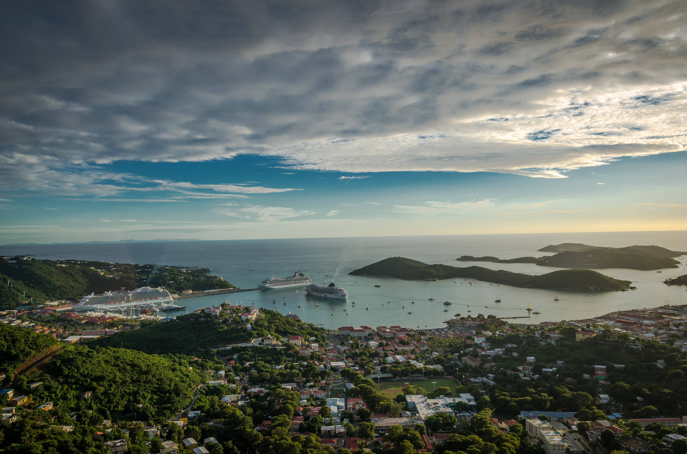
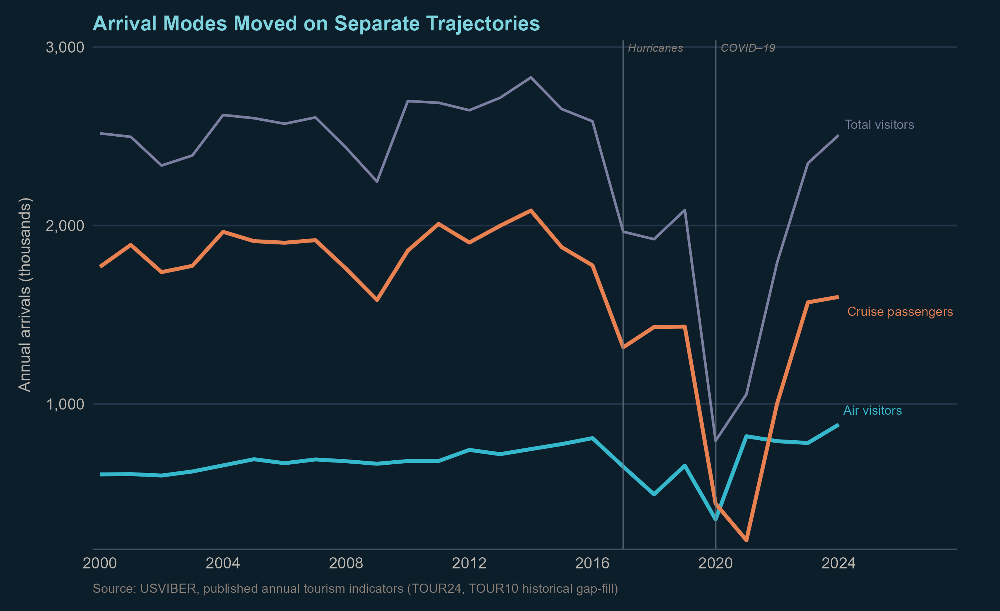

```{=html}
<style>
#title-block-header {
  display: none !important;
}
#quarto-content {
  padding-top: 0;
}
#quarto-content main.content {
  padding-top: 0 !important;
  margin-top: 0 !important;
}
.pub-hero {
  margin-top: 0 !important;
}
</style>
```

```{python}
#| echo: false
#| output: false
import pandas as pd
from pathlib import Path
PROC = Path("../data/processed")

# Load processed data for inline values only
visitors = pd.read_csv(PROC / "visitors_annual.csv")
fred     = pd.read_csv(PROC / "employment_fred_annual.csv")
bea_af   = pd.read_csv(PROC / "bea_af_real.csv")
bea_gdp  = pd.read_csv(PROC / "bea_gdp_real.csv")
nps      = pd.read_csv(PROC / "nps_viis.csv")
hotel    = pd.read_csv(PROC / "hotel_annual.csv")

v16  = visitors[visitors.year == 2016].iloc[0]
v24  = visitors[visitors.year == 2024].iloc[0]
e16  = fred[fred.year == 2016].iloc[0]
e25  = fred[fred.year == 2025].iloc[0]
af21 = bea_af[bea_af.year == 2021].iloc[0]
af16 = bea_af[bea_af.year == 2016].iloc[0]
gdp22 = bea_gdp[bea_gdp.year == 2022].iloc[0]
gdp16 = bea_gdp[bea_gdp.year == 2016].iloc[0]
nps25 = nps[nps.year == 2025].iloc[0]
nps16 = nps[nps.year == 2016].iloc[0]

air_pct   = round(v24.air_visitors / v16.air_visitors * 100)
cruise_pct = round(v24.cruise_passengers / v16.cruise_passengers * 100)
total_pct  = round(v24.total_visitors / v16.total_visitors * 100)
rooms_pct  = round(v24.hotel_rooms / v16.hotel_rooms * 100)
emp_pct25  = round(e25.emp_sa_avg / e16.emp_sa_avg * 100)
af_pct     = round(af21.af_real / af16.af_real * 100)
gdp_pct    = round(gdp22.gdp_real / gdp16.gdp_real * 100)
nps_pct    = round(float(nps25.recreation_visitors) / float(nps16.recreation_visitors) * 100)
nps25_k    = round(float(nps25.recreation_visitors) / 1e3)
```

::::: {.pub-hero}


:::: {.hero-overlay}
::: {.hero-label}
U.S. Virgin Islands · 2000–2025
:::

::: {.hero-title}
Trade Winds &<br>Headwinds
:::

::: {.hero-subtitle}
Twenty-Five Years of Tourism and Economic Change in the U.S. Virgin Islands
:::

::: {.hero-meta}
Bryan Johns · November 2026
:::

::: {.hero-question}
"The visitors came back. Did the economy?"
:::
::::
::: {.img-attribution}
Photo: Sunil Pereira, [CC BY-SA 3.0](https://creativecommons.org/licenses/by-sa/3.0/), via Wikimedia Commons.
:::
:::::

## The central question

The U.S. Virgin Islands' tourism economy survived two catastrophic shocks: Hurricanes Irma and Maria in September 2017, and the COVID-19 shutdown of 2020. The first destroyed infrastructure as well as demand. The second interrupted travel before the islands had fully recovered from the first.

The useful question is not whether tourism is back. It is whether the economy that reappeared is the same economy that existed before the storms.

The evidence produces a mixed answer. By 2024, published arrivals were close to 2016 levels. Air arrivals exceeded them. Cruise traffic did not. Hotel rooms remained fewer; published occupancy was higher. Broad Leisure and Hospitality employment was still below its former annual average. And by 2021, the latest available year, real Accommodation and Food Services value added had not returned to its 2016 level.

Arrivals, capacity, labor, and economic output are not telling the same recovery story.

## Recovery at a glance

The figures below are indexed to 2016 = 100, except where noted. They come from different sources and have different latest observation years. They are not from a single common year.

```{python}
#| echo: false
items = [
    ("Air arrivals",          f"{air_pct}%",    "2024 vs. 2016 · USVIBER",                "above-baseline", min(air_pct / 125 * 100, 100)),
    ("Cruise passengers",     f"{cruise_pct}%", "2024 vs. 2016 · USVIBER",                "below-baseline", min(cruise_pct / 125 * 100, 100)),
    ("Total arrivals",        f"{total_pct}%",  "2024 vs. 2016 · USVIBER",                "near-baseline",  min(total_pct / 125 * 100, 100)),
    ("NPS recreation visits", f"{nps_pct}%",    "2025 vs. 2016 · VIIS estimated visits",  "above-baseline", min(nps_pct / 125 * 100, 100)),
    ("Hotel inventory",       f"{rooms_pct}%",  "2024 vs. 2016 · USVIBER survey",          "below-baseline", min(rooms_pct / 125 * 100, 100)),
    ("L&H employment",        f"{emp_pct25}%",  "2025 vs. 2016 annual mean · FRED/BLS",   "below-baseline", min(emp_pct25 / 125 * 100, 100)),
    ("Real territorial GDP",  f"{gdp_pct}%",    "2022 vs. 2016 · BEA (whole economy)",   "above-baseline", min(gdp_pct / 125 * 100, 100)),
    ("Real A&F value added",  f"{af_pct}%",     "2021 vs. 2016 · BEA (latest available)", "below-baseline", min(af_pct / 125 * 100, 100)),
]

from IPython.display import display, HTML

html = ['<div class="scorecard-grid">']

for label, value, context, cls, bar_w in items:
    html.append(f'''
      <div class="scorecard-item {cls}">
        <div class="sc-label">{label}</div>
        <div class="sc-value">{value}</div>
        <div class="sc-context">{context}</div>
        <div class="sc-bar-track">
          <div class="sc-bar-fill" style="width:{bar_w}%"></div>
        </div>
    </div>''')

html.append('</div>')

display(HTML('\n'.join(html)))
```

---

## Two shocks, two kinds of disruption

:::{.section-intro}
The 2017 hurricanes and the 2020 pandemic interrupted tourism in fundamentally different ways. Irma and Maria caused physical destruction — to hotels, infrastructure, and the natural environment. COVID-19 stopped travel demand without comparable physical damage. The recovery trajectories reflect both disruptions.
:::

The 2017 storms struck in September, after much of that year's visitation had already occurred. Their full economic consequences showed in 2018. COVID-19 hit in March 2020, collapsing both air and cruise traffic in the same season.

::: {#fig-arrivals}
{.light-content fig-alt="Line chart showing air visitor and cruise passenger arrivals from 2000 to 2024 with shock markers at 2017 and 2020"}

{.dark-content fig-alt="Line chart showing air visitor and cruise passenger arrivals from 2000 to 2024 with shock markers at 2017 and 2020"}

Published total visitors is a USVIBER aggregate. Air visitors and cruise passengers are separate arrival counts and should not be assumed to sum to the total.
:::

By 2024, air visitors had reached 109% of their 2016 level, while cruise passengers were at 90%. The published total — 2.507 million — was 97% of 2016. These are arrivals, not visitor-days, and do not indicate how long visitors stayed or how much they spent.

The character of the pandemic disruption was distinct. In 2020, cruise passengers fell to 25% of their 2019 level, while air visitors fell to 32%. Both rebounded, but on different timelines. Cruise traffic in particular has not returned to its pre-hurricane trajectory.

## A smaller accommodation base

:::{.context-panel}
**Geographic context:** The accommodation shortfall is concentrated on St. Thomas and St. John. By 2024, available room-nights on St. Thomas–St. John were 75% of their 2016 level. St. Croix's hotel capacity, measured in available room-nights, was 95% of 2016. The territory-wide accommodation deficit reflects damage and unrebuilt capacity on the two northern islands.
:::

USVIBER's reported hotel-room inventory stood at 3,127 rooms in 2024, 82% of the 3,819 reported in 2016. The Census Economic Census provides a different count, covering a different population of payroll-filing establishments: 2,039 accommodation guestrooms in 2022, compared with 5,027 in 2012. Because the Census counts a different population and changed its guestroom product definition in 2017, these numbers cannot be combined. Together, however, they describe a capacity constraint.

::: {#fig-recovery}
{.light-content fig-alt="Line chart comparing key recovery indicators indexed to 2016 = 100"}

{.dark-content fig-alt="Line chart comparing key recovery indicators indexed to 2016 = 100"}

Four indicators indexed independently to 2016 = 100. Latest observation years differ: visitors through 2024, employment through 2025.
:::

The result of a smaller inventory is a higher published occupancy rate on a smaller stock. USVIBER reports 66.3% occupancy in 2024, 9.6 percentage points above the 56.7% reported in 2016. Higher utilization on a smaller base does not mean more occupied room-nights overall — it means the remaining inventory was used more intensively.

## Employment and the people behind the industry

FRED's Leisure and Hospitality series provides the longest consistent employment signal. It covers NAICS 71 and 72 — arts, entertainment, accommodation, and food services — not tourism employment alone. Its annual average fell from 7.69 thousand in 2016 to a 2020 low of 4.78 thousand, recovered to 7.65 thousand in 2023, fell to 6.98 thousand in 2024, and reached 6.49 thousand in 2025. At 84% of the 2016 annual mean in 2025, the broad sector had not returned to its pre-hurricane scale.

QCEW data for the Accommodation and Food Services subsector (NAICS 72) show a similar trajectory. At the territory level, annual average employment was 6,775 jobs in 2016, fell to 3,826 in 2020, and reached 6,275 in 2025.

These are complementary measures of a related labor market. Neither is a count of tourism jobs specifically, and neither can establish whether individual workers' incomes have returned to pre-hurricane levels.

## Spending and economic output

Nominal visitor expenditure reached $1.829 billion in 2024, 98% of the $1.873 billion recorded in 2016. After converting with mainland CPI-U, an approximate real comparison yields $1.399 billion in approximate 2016 dollars — 75% of the 2016 level. That adjustment is a mainland price proxy, not a USVI-specific purchasing-power estimate.

BEA real Accommodation and Food Services value added reached 87% of its 2016 level in 2021, the latest available industry observation. This series covers resident-serving food and accommodation activity and excludes tourism-related spending in transportation, retail, and recreation. It cannot establish the size of the tourism economy in isolation, and it cannot isolate the effect of federal disaster-recovery spending on the broader territorial economy.

Real GDP, which covers the entire USVI territorial economy, rose to 119% of its 2016 level by 2022. That is a broader economy indicator, not evidence of tourism recovery.

## The National Park signal

Virgin Islands National Park received an estimated `{python} nps25_k` thousand estimated recreation visits in 2025, `{python} nps_pct`% of the 2016 total.

Park visitation is a separate signal from territory-wide arrivals. The park's visits are estimated, not counted; they represent visits rather than unique people; and the counting methodology changed before 2022. A 2026 traffic-counter approach at two key locations produced counts about three times the normal range and is excluded here. The park's stronger recovery may reflect a shift toward outdoor recreation, different visitor patterns, or simply differences in estimation methods.

The park's signal is consistent with the broader picture — activity above 2016 levels in some measures, without establishing that the full tourism economy has returned.

## The strongest interpretation

:::{.closing-synthesis}
The USVI appears to have recovered much of its **visitor flow**, but not necessarily the full **scale or structure** of the tourism economy that existed in 2016. The evidence is consistent with a smaller accommodation stock operating at higher occupancy, uneven labor recovery, and visitor activity that does not map cleanly onto industry output.

That conclusion is not a claim that the economy has been permanently transformed. Later observations, especially for 2025 and beyond, may revise the picture. It is a statement about what can be established now: the two major shocks did not leave all indicators at the same stage of recovery.
:::

The analysis that follows examines the evidence source by source. It separates visitor counts, room capacity, employment definitions, output measures, and the methodological limits that determine what each comparison can and cannot support.

[Read the full analysis →](analysis.qmd){.to-analysis-link}
